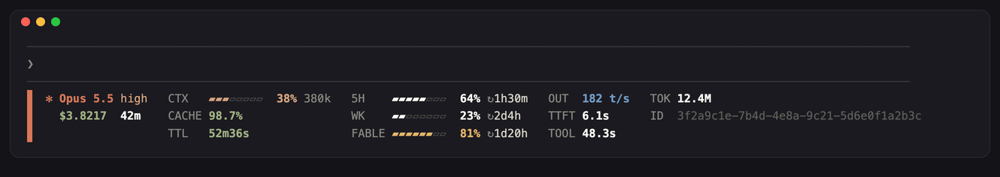

<div align="center">

# claude-code-panel

**把 Claude Code 的状态栏变成一块对齐、会动的实时面板。**

上下文、5 小时 / 每周 / Fable 额度和重置倒计时、提示缓存剩余时间、花费、输出速度、会话 ID，一眼看完；Claude 干活时面板会动。

[English](README.md) · 简体中文



</div>

## 特点

- **是一块，不是一条**：左侧色条把三行对齐的信息连成一个整体。
- **其他订阅也能看**：Codex（ChatGPT）周额度和重置次数、X / Grok 共用周额度、Google AI（Antigravity）额度、DeepSeek 余额，在面板下方各占一行，用各自品牌色；一个快捷键就能隐藏或显示。
- **额度放一列**：`WK`、`FABLE` 两根格子条上下叠放，后面跟 `↻` 重置倒计时。
- **快满了会提醒**：超过 70% 变琥珀色，超过 90% 变红。
- **缓存倒计时**：`TTL` 显示提示缓存还剩多久过期（绿 → 琥珀 → 红 → `cold`），过期后下一条消息会贵很多。
- **干活时会动**：Claude 工作时 `✻` 转圈、色条呼吸；空闲时静止。
- **很轻**：每秒重画一次只要约 30 毫秒，重计算只在会话数据变化时才跑。
- **一个文件**：单个 Python 脚本，不需要额外的 Python 依赖。

## 安装

```sh
curl -fsSL https://raw.githubusercontent.com/risingjerry/claude-code-panel/main/install.sh | sh
```

安装脚本会把 `cc-panel` 放到 `~/.local/bin`，没有 [ccstatusline](https://github.com/sirmalloc/ccstatusline) 时自动安装，先备份 `~/.claude/settings.json` 再写入 `statusLine` 配置（`refreshInterval: 1`）。不开 Claude Code 也能预览：`cc-panel --demo`。

## 各项含义

| 字段 | 含义 |
|---|---|
| `✻ Opus 5.5 high` | 模型和推理档位 |
| `$3.8217  42m` | 本次会话花费（按 API 价格估算，和 `/cost` 一致）和时长 |
| `CTX` | 上下文占用和 token 数；分母是自动压缩窗口（`autoCompactWindow` 或 `CLAUDE_CODE_AUTO_COMPACT_WINDOW`，没设就用模型上限），100% 即将压缩 |
| `CACHE` | 提示缓存命中率 |
| `TTL` | 提示缓存还剩多久过期 |
| `WK` / `FABLE` | 每周、Fable 每周额度；`↻` 后是距离重置的时间 |
| `GPT` | Codex 周额度和重置倒计时；`RESET` 是剩余的额度重置次数（有的话显示最早一次的过期时间） |
| `Grok` | X 订阅的每周额度（Grok、Grok Build、Grok Bot、Cursor 共用），按 `Bot` / `Build` / `API` 拆分 |
| `Argon` | Google AI 订阅（Antigravity）：Gemini 4 Argon 单独的周额度和重置倒计时（比 Gemini 总额度先用完），旁边是 `Gemini` 总额度和 `Opus·Sonnet` 额度（Antigravity 里的 Claude 和 GPT 模型），各分 `5H` / `WK` |
| `DeepSeek` | DeepSeek API 余额（`BAL`） |
| `OUT` | 输出速度（token/秒） |
| `TTFT` | 平均首段等待时间（首个 token 时间的上限） |
| `TOOL` | 工具调用总耗时（并行调用只算一次） |
| `TOK` | 本次会话累计 token |
| `ID` | 会话 ID，可用于 `claude --resume` |

## 其他订阅

本机登录了对应命令行工具时，这几行会自动出现：

- **GPT**：需要已登录的 `codex`。读的是 Codex 自带的 `app-server`，不消耗额度。
- **Grok**：需要已登录的 `grok`（Grok Build）。只读它的登录；登录过期时这一行变灰，下次用 `grok` 会自动续上。
- **Argon**（Google AI）：需要已登录的 Antigravity 命令行（`agy`）。用 `agy -p /usage` 读取，不消耗额度。
- **DeepSeek**：要自己开启。在 `~/.config/cc-panel/config.json` 里写一条把 API 密钥输出到文件描述符 3 的命令，比如从密钥管理工具读：

  ```json
  {"deepseek_key_command": "my-secrets get --fd 3 DEEPSEEK_API_KEY"}
  ```

刷新在后台进行：全机同时只有一个刷新进程，Codex 每 5 分钟、Grok 和 Google 每 10 分钟、DeepSeek 每 15 分钟查一次，失败后等待时间加倍（最长 1 小时），开再多会话也不会被限流。没更新上的数值显示为灰色。

`cc-panel --toggle` 隐藏或显示这一块（隐藏时也不再后台刷新）。想绑全局快捷键：在 Raycast 设置 → Script Commands → Script Folders 里加入 `extras/raycast`（或它的副本），再给 *Toggle Claude Code Panel Subscriptions* 录一个快捷键。设置 `CC_PANEL_QUOTAS=0` 可整体关闭。

## 常见问题

**能不能显示权限模式（bypass / plan）？** 不能。`▶▶ bypass permissions on` 那一行是 Claude Code 自己画在状态栏下面的，状态栏收到的数据里也没有权限模式。面板文字已经和那一行对齐，看起来是一个整体。

**会不会拖慢 Claude Code？** 不会。重画一次约 30 毫秒，约 1 秒的 ccstatusline 计算只在数据变化时运行，也不会阻塞 Claude 本身。

## 配合 Claude Code 使用

让 Claude Code 帮你安装和管理。先装上自带的 skill，然后直接说人话：

```sh
npx skills add risingjerry/claude-code-panel
```

- 「帮我安装 claude-code-panel。」
- 「先给我预览一下 claude-code-panel 的状态栏，别改任何配置。」
- 「卸载 claude-code-panel，恢复我原来的状态栏。」

skill 会先备份 `~/.claude/settings.json`，只改 `statusLine` 这一项。详见 [`skills/claude-code-panel/SKILL.md`](skills/claude-code-panel/SKILL.md)。

## 卸载

恢复 `~/.claude/settings.json.bak-cc-panel`（或删掉 `statusLine` 配置），再删除 `~/.local/bin/cc-panel` 和 `~/.cache/cc-panel`。

---

觉得好用的话，点个 ⭐ 能让更多 Claude Code 用户看到它。

[](https://star-history.com/#risingjerry/claude-code-panel&Date)

[MIT](LICENSE)
